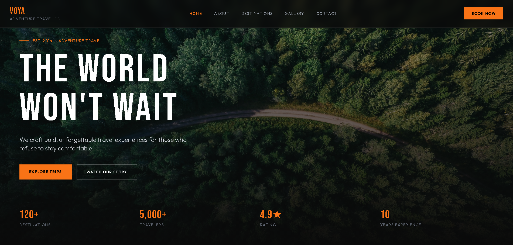

# 🌍 VOYA — Adventure Travel Co.

A bold, responsive landing page for a fictional adventure travel company — built with pure HTML, Tailwind CSS, and vanilla JavaScript. No frameworks, no build tools, just the basics.



---

## ✨ Features

- Dark, editorial design with orange accent system
- Fully responsive with mobile hamburger menu
- Scroll-triggered fade-in animations
- Active nav highlighting on scroll
- Destination cards with hover effects
- Masonry-style gallery grid
- Working contact form with submit feedback
- Auto-updating copyright year

---

## 📁 File Structure
voya/
- `index.html` — markup and structure
- `styles.css` — custom styles
- `script.js` — interactivity and animations
- `README.md` — project documentation
- `images/` — all local images

---

## 🚀 Getting Started

1. Clone the repo:
```bash
git clone https://github.com/mors-codes/voya.git
```

2. Open the folder:
```bash
cd voya
```

3. Open `index.html` in your browser — done!

> No installs, no build steps, no dependencies.

---

## 🛠️ Built With

- HTML5
- CSS3
- [Tailwind CSS](https://tailwindcss.com/) via CDN
- JavaScript (ES6+)
- [Bebas Neue + Outfit](https://fonts.google.com/) — Google Fonts

---

## 📄 License

This project is open source and available under the [MIT License](LICENSE).